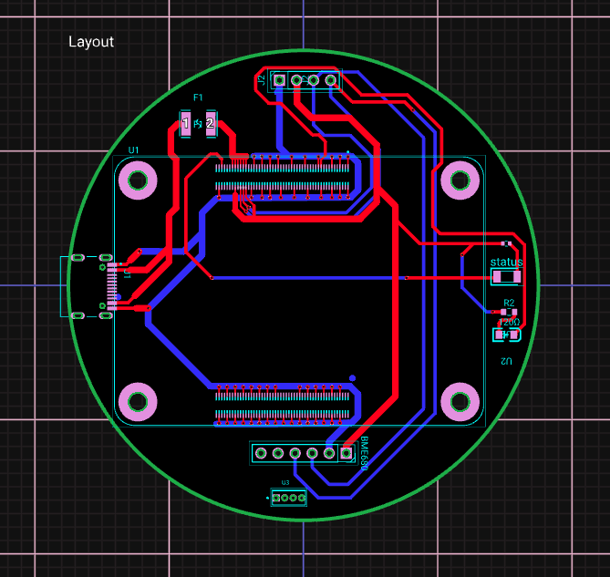
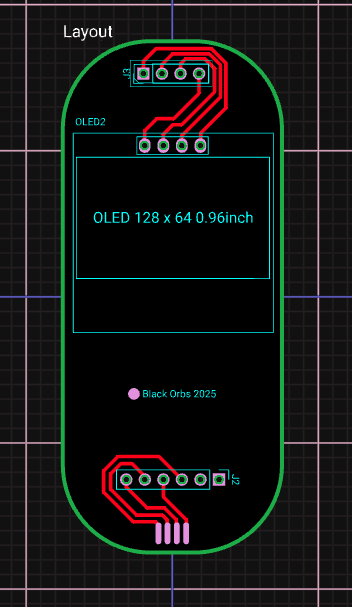

# Hardware — Edge Device PCB

Custom carrier board for the **Raspberry Pi Compute Module 5** with a **Sensirion SHT85** temperature/humidity sensor (I2C `0x44`) and an SSD1306 OLED display (I2C `0x3C`).

## PCB Images

### Carrier Board


### Second PCB Revision


## Manufacturing

The `gerbers/` folder contains the production-ready Gerber files packaged as a `.zip`.

**To order PCBs:**
1. Go to any PCB manufacturer (JLCPCB, PCBWay, OSH Park, etc.)
2. Upload `gerbers/gmlalo-comblinkiav1-Gerbers-*.zip`
3. Select your preferred stackup (standard 2-layer FR4 is sufficient)

## Measured Variables

| Variable | Sensor | Unit |
|----------|--------|------|
| Temperature | SHT85 | °C |
| Relative Humidity | SHT85 | % RH |

## Software

The board runs the Python read loop in [`sensor/`](../sensor), which samples the
SHT85 every 60 s (5-sample average, offsets from `sensor/calibration.json`) and
posts to the local API:

```json
{ "temperature": 25.30, "humidity": 42.10 }
```

Endpoint: `POST http://localhost:3001/data`
